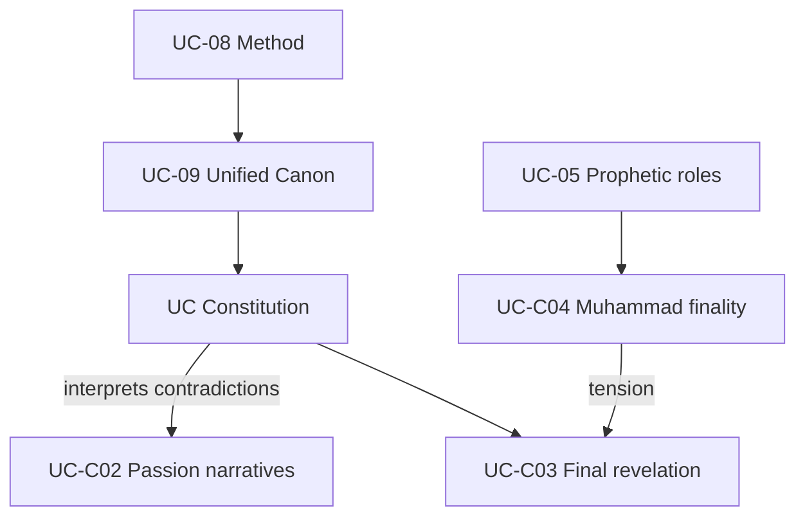

# Phase 6.3 — Canon Hierarchy, Revelation, and Prophetic Finality

**Status:** Research module.  
**Feeds:** UC-09, UC-C03, UC-C04, UC-05, UC-12, §7.3, §10.

---

## 1. Current UC model (v0.2) — statement

**Unified Canon (UC-09 B):**

1. **Tanakh** — foundation witness  
2. **New Testament** — witness to Christ (UC Christology)  
3. **Qur’an** — witness to 7th-c. prophetic restoration  
4. **UC Constitution** — **governing interpretive authority** for membership doctrine  

**Series finality (§7.3 / UC-C04):** Muhammad as **seal of Abrahamic canonical series** in UC — **not** absolute closure of all divine speech; no new **canonical** layer without §10 revision.

**Prophetic continuity (UC-05 B):** Distinct roles; not interchangeable prophets.

---

## 2. Contradiction and dependency map

| Tension | Description |
|---------|-------------|
| **UC Constitution wins?** | When layers conflict, **B** doctrine + §2 reconciliation **defaults** to UC Constitution — **risk of circularity** (canon interpreted by document that claims authority over canon) |
| **Islamic finality** | Q 33:40 **khātama al-nabiyyīn** — dominant **R** = **no prophet after Muhammad** (`quran-33-40-seal-prophets`) |
| **UC series finality** | **Reinterprets** seal as **canonical closure**, allows Christological centrality — **not** identical to Islamic **R** |
| **Christian finality** | **Christ** as decisive revelation — **in tension** with Qur’an as **final** in Islamic **R** and with UC layered model |
| **Jewish Torah** | **Eternal** Torah + oral — **not** “layer 1 of 4” in **R** Judaism |

---

## 3. Qur’an 33:40 — scholarly interpretations (sample)

| Reading | Meaning of *khātama al-nabiyyīn* | Sources |
|---------|----------------------------------|---------|
| **Classical (al-Ṭabarī)** | Seal = **end** of prophets until Hour | Tafsīr 33:40 (tafseerquran.com summary); registry |
| **Lexical** | *Khātam* vs *khātim* (fatḥa vs kasra) — “last” vs “sealer” | al-Ṭabarī; al-Farrāʾ traditions |
| **Academic (Friedmann; Pregill)** | Finality **developed** over time; early **confirmation/ratification** sense possible | `friedmann-finality-prophethood`; Lambden 2018 PDF survey |
| **Bahā’ī (minority)** | Final in **Prophetic Cycle**, not all revelation | MDPI 2023 article — **not** Sunni/Shīʿī norm |

**UC “series finality”:** **B** — **preserves language**, **reinterprets** scope. **Classification:** **Plausible but contested**; **borrowed language**, **different concept** from dominant Islamic **R**.

---

## 4. Alternatives to current hierarchy

| Model | Description | Preserves | Sacrifices |
|-------|-------------|-----------|------------|
| **A — Current v0.2** | 4-layer + UC Constitution supreme for **B** | Structured study; UC governance | Islamic/Christian/Jewish **finality** claims as normative |
| **B — Parallel registers** | Three **R** canons + UC **only** for ethics/governance, **no** theological adjudication | Maximum **R** autonomy | **Weak** “unified religion” |
| **C — Christocentric hierarchy** | NT interpretive key over Tanakh + Qur’an as commentary | Nicene-adjacent Christianity | Islam; Judaism |
| **D — Qur’an-final hierarchy** | Qur’an supersedes prior layers theologically | Dominant Islamic **R** | Christianity; Judaism |
| **E — No hierarchy — anthology** | v0.1-style library; UC **minimal** | Honest comparison | **No** unified doctrine |

**Coherence test:** Model **A** **requires** §2 reconciliation + maintainer docket; otherwise **Constitution wins** — **document in MD-03**.

---

## 5. Historical vs interpretation vs R vs B (operational rules)

| Domain | Rule (recommended) |
|--------|---------------------|
| **H** | Binds UC **historical curriculum** only |
| **Textual criticism** | **H** on manuscripts; **does not** alone prove *taḥrīf* |
| **Inherited R** | Full voice in reconciliation; **not** veto over **B** for members |
| **UC B** | Membership essentials |
| **Revision (UC-12)** | May amend **B** and **canon policy**; should **not** silently erase **H** without new evidence |

**New historical evidence vs doctrine:** §10 should require **explicit** H-update process — **gap in v0.2** (recommend Phase 6.4 procedure row).

---

## 6. Separate questions (recommended)

| # | Question | Currently conflated? |
|---|----------|---------------------|
| 1 | **Canonical closure** — any new scripture? | Partially with prophetic finality |
| 2 | **Prophetic finality** — any new **nabī**? | UC-C04 vs Islamic **R** |
| 3 | **Ongoing divine guidance** — *walī*, Spirit, inspiration | **Open** in v0.2 |
| 4 | **UC revision** — meta-canonical changes | UC-12 |

**Recommendation:** Split in maintainer docket **MD-04** (finality) and **MD-03** (hierarchy).

---

## 7. Circular authority problem

**Charge:** UC Constitution interprets the canon that grants it authority (layer 4).

**Mitigation options (for maintainer):**

1. **Constitution as meta-layer only** — cannot override **verbatim** text without **§2** trace; **dissent log** mandatory.  
2. **Frozen scriptural layers** — only **interpretive articles** revisable.  
3. **Council supermajority** for canon-touching revisions.

**Current v0.2:** **Partial** mitigation (§2, §10) — **insufficient** explicit anti-circularity rule.

---

## Sources

- `quran-33-40-seal-prophets`, conv. §3, §5; matrix § D, § F
- Friedmann, *Prophecy Continuous* (1989) — `friedmann-finality-prophethood`
- Lambden, “Seal of the Prophets” (2018 PDF, UC Merced) — survey
- al-Ṭabarī on 33:40 — `tabari-tafsir-33-40-seal` (registry pointer)
- v0.2 UC-09, §7, §10

*Not project doctrine.*
